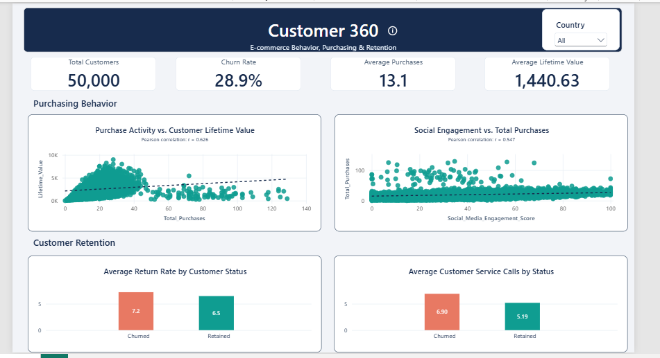

# E-commerce Customer Behavior Analysis

An exploratory data analysis project investigating customer engagement, purchasing behavior, customer lifetime value, and churn using Python and Power BI.

## Project Overview

This project analyzes an e-commerce customer dataset containing **50,000 customer records and 25 variables** to explore patterns in customer activity, purchasing behavior, and retention.

Using Python for data cleaning, exploratory data analysis (EDA), and visualization, the project investigates six research questions. A Power BI dashboard presents selected findings in a business-oriented format.

The objective is to demonstrate a complete data analytics workflow, from initial data inspection and preprocessing to statistical analysis, visualization, and dashboard development.

> **Note:** The dataset is synthetic. Findings describe patterns within this dataset and should not be interpreted as verified evidence of real-world customer behavior.

## Dashboard Preview



*Power BI dashboard summarizing customer purchasing behavior and retention-related metrics.*

## Project Objectives

- Investigate the relationship between login frequency and purchase recency.
- Examine the association between social media engagement and total purchases.
- Analyze the relationship between discount usage and purchasing behavior.
- Compare returns rates and customer service calls between retained and churned customers.
- Explore the association between total purchases and customer lifetime value.
- Investigate the relationship between membership duration and login frequency.

## Tools and Technologies

| Tool | Purpose |
|---|---|
| Python | Data analysis and preprocessing |
| Pandas | Data inspection, cleaning, filtering, and aggregation |
| Matplotlib | Data visualization |
| Jupyter Notebook | Interactive analysis and documentation |
| Power BI | Business-focused dashboard development |

## Dataset

**Source:** [Ecommerce Customer Behavior Dataset — Kaggle](https://www.kaggle.com/datasets/dhairyajeetsingh/ecommerce-customer-behavior-dataset/data)

- **Records:** 50,000
- **Variables:** 25
- **Data type:** Synthetic customer behavior data

The dataset contains information about customer demographics, membership duration, login frequency, purchase activity, engagement, discount usage, returns, customer service interactions, lifetime value, and churn.

## Methodology

### 1. Data Inspection

- Examined dataset dimensions, column names, and data types.
- Assessed missing values and their distribution across columns.
- Checked for duplicate records.
- Reviewed descriptive statistics and identified potentially invalid or implausible values.

### 2. Data Cleaning and Preprocessing

- Preserved the original dataset and performed cleaning on a working DataFrame.
- Replaced implausible age values below 14 or above 100 with a flag value of `0`.
- Treated discount usage and cart abandonment rates above 100 as missing values.
- Replaced negative total purchase counts with missing values.
- Rounded total purchase counts to the nearest whole number.
- Retained missing values where appropriate and filtered records separately for each analytical question.

These decisions were made to improve consistency while avoiding unnecessary removal of entire customer records.

### 3. Exploratory Data Analysis

Used scatter plots, bar charts, summary statistics, and Pearson correlation coefficients to examine the six research questions.

Correlation coefficients were used to assess linear associations. They do not establish causation.

### 4. Dashboard Development

Developed a Power BI dashboard to present selected purchasing behavior and customer retention findings through key performance indicators and visual comparisons.

## Key Findings

### 1. Login Frequency vs. Days Since Last Purchase

**Correlation: 0.0036**

The analysis found a negligible linear relationship between login frequency and days since the last purchase.

### 2. Social Media Engagement vs. Total Purchases

**Correlation: 0.5469**

The analysis found a moderate positive linear association between social media engagement scores and total purchase counts. Customers with higher engagement scores tended to have higher purchase counts in the observed data.

### 3. Discount Usage vs. Total Purchases

**Correlation: 0.0321**

The analysis found a negligible linear relationship between discount usage rate and total purchases. This does not rule out other potential relationships between discount usage and purchasing behavior.

### 4. Customer Retention and Churn

Compared the average returns rate and average number of customer service calls between retained and churned customers.

These comparisons provide a descriptive view of differences between the two groups. The actual group averages should be consulted when interpreting the magnitude of those differences.

### 5. Total Purchases vs. Customer Lifetime Value

**Correlation: 0.6260**

The analysis found a moderate-to-strong positive linear association between total purchases and customer lifetime value. Customers with higher purchase counts tended to have higher lifetime values in the observed data.

### 6. Membership Duration vs. Login Frequency

**Correlation: 0.0023**

The analysis found a negligible linear relationship between membership duration and login frequency.

### Overall Insight

Among the selected relationships, social media engagement and total purchases, and total purchases and customer lifetime value, showed the clearest positive linear associations. The other three correlations were close to zero.

These results are descriptive and apply only to the supplied dataset.

## Visualizations

The project includes the following analytical charts:

| Analysis | Visualization |
|---|---|
| Login Frequency vs. Purchase Recency | `login_frequency_vs_days_since_last_purchase.png` |
| Social Media Engagement vs. Total Purchases | `total_purchases_vs_social_media_score.png` |
| Discount Usage vs. Total Purchases | `total_purchases_vs_discount_usage_rate.png` |
| Returns Rate by Customer Status | `returns_rate_of_churnedvsretained.png` |
| Customer Service Calls by Customer Status | `customer_service_calls_of_churnedvsretained.png` |
| Total Purchases vs. Lifetime Value | `total_purchases_vs_lifetime_value.png` |
| Membership Duration vs. Login Frequency | `membership_years_vs_login_frequency.png` |

All chart images are stored in the `images/` directory.

## Repository Structure

```text
ecommerce-customer-behavior-analysis/
│
├── README.md
├── ecommerce_customer_behavior_analysis.ipynb
└── images/
    ├── Dashboard.PNG
    ├── login_frequency_vs_days_since_last_purchase.png
    ├── total_purchases_vs_social_media_score.png
    ├── total_purchases_vs_discount_usage_rate.png
    ├── returns_rate_of_churnedvsretained.png
    ├── customer_service_calls_of_churnedvsretained.png
    ├── total_purchases_vs_lifetime_value.png
    └── membership_years_vs_login_frequency.png
```

## How to Run the Project

### Prerequisites

- Python 3.10 or a compatible Python environment
- Jupyter Notebook or Visual Studio Code with Jupyter support
- The dataset downloaded from Kaggle

### 1. Clone the Repository

```bash
git clone https://github.com/Ali-cd12/ecommerce-customer-behavior-analysis
cd ecommerce-customer-behavior-analysis
```

### 2. Install Dependencies

The main Python libraries used are:

```text
pandas
matplotlib
jupyter
ipykernel
```

### 3. Download the Dataset

Download the dataset from [Kaggle](https://www.kaggle.com/datasets/dhairyajeetsingh/ecommerce-customer-behavior-dataset/data). Rename the csv as `customer_behavior.csv`  and place in the project directory, alongside the notebook.

The notebook generates `cleaned_dataset.csv` during preprocessing.

### 4. Run the Notebook

Open `ecommerce_customer_behavior_analysis.ipynb` in Jupyter Notebook or Visual Studio Code, then run the cells from top to bottom.

**Note:** The notebook saves chart images to the `images/` directory. Ensure this directory exists before running the visualization cells.

## Limitations

- The dataset is synthetic and may not reflect actual customer behavior.
- Missing values mean that individual analyses can use different sample sizes.
- Pearson correlation captures linear association and may not reveal nonlinear relationships.
- Correlation does not imply causation.
- Cleaning decisions influence the resulting analysis and should be considered when interpreting the findings.
- Further validation using real-world data would be required before applying these observations to business decisions.

## Conclusion

This project demonstrates a practical data analytics workflow involving data inspection, cleaning, exploratory analysis, visualization, and dashboard development.

The analysis identifies positive associations between social media engagement and total purchases, and between total purchases and customer lifetime value. Other selected relationships show negligible linear associations, while group comparisons explore differences between retained and churned customers.

The accompanying Power BI dashboard communicates selected findings in a business-oriented format. Together, the notebook and dashboard demonstrate the use of Python and Power BI to explore customer behavior and communicate analytical results.

---

**Project Focus:** Data Analytics | Exploratory Data Analysis | Customer Behavior | Customer Retention | Power BI